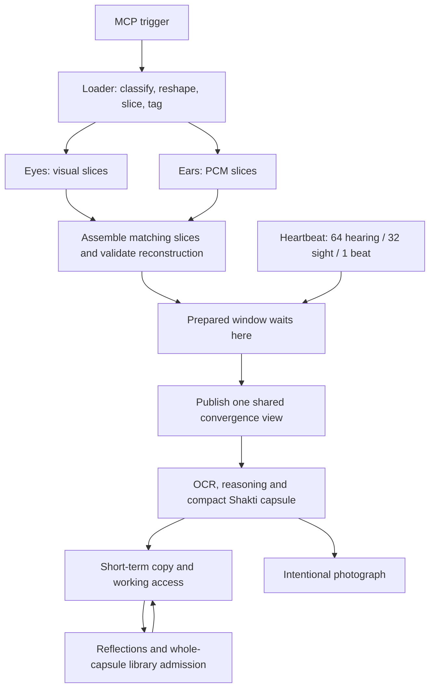

# Shakti — operating Guide

Updated 2026-10-19. Owner: Tyler Allen Lofall.
Repository: TylerALofall/Shakti_No_Dream_WithOut_The_Team.

This is the single project README and operating Guide. Read this before
choosing a source file or starting a new implementation. It carries the
section meanings, component boundaries, current source map and work method.
Sealed tool-package records describe their own versions; they are not
alternate project architecture guides.

**Current bounded scope:** Tyler's eight-stage loader/senses pipeline, drawn
below, is implemented and exercised as a native C RUN. This does not close
the whole model, general OCR, speech recognition, the Apple host or the
three offset clones. No other project scope is inferred from these results.

## 1. Start a session here

1. Record the repository, branch and exact commit being inspected.
2. Find the component's logical section in the table below.
3. Check the current source map: an intended home is not proof that code
   already lives there or is connected.
4. Read the affected source, its public interface and its actual callers.
   Reuse the existing implementation. Resolve competing copies explicitly.
5. State the bounded change, incoming data, outgoing data and buffer owner.
6. Review the changed source before compiling; inspect the build result
   before the separate native RUN. Publish only the authorized scope.
7. Record the result and remaining gaps here or in the existing package
   evidence. Do not create another project operating guide.

Work section by section. A repository inventory is a navigation index,
not a claim that someone has read or qualified every file. Follow changed
code and its dependencies; keep cross-section handoffs traceable.

## 2. Standing implementation rules

- C99, deterministic byte processing and fixed bounded storage.
  No explicit malloc/calloc/realloc/free or heap-owned model state.
- No Python or Node in, on or against Shakti files. Delivered tools do not
  launch compilers, subprocess builders or hidden background work.
- Review source before build, and build output before RUN. Reading and
  making an adaptive edit are separate reviewed actions.
- No external links, W3C/SVG tags, remote assets, trackers or dependencies
  added to Shakti artifacts or tools. Device access is explicit.
- Capacity overflow refuses the whole item with a clear BENCH. Never admit
  a truncated frame, clip, capsule or partial generated output.
- Keep one authoritative implementation for each runtime job. A kernel
  caller does not take ownership of a subsystem merely by calling it.
- Preserve section meanings and existing identities. A proposed rename,
  replacement or move must be visible in the scope and Git change list.
- Native RUNs supply actual evidence. Synthetic fixtures, injected boundary
  positions and missing independent review must be identified honestly.
- Existing tools are reused and packaged through the native README
  assembler in the Menu tool bank. Registry and seal history are append-only.

## 3. Section meanings

These meanings come from Tyler's supplied Guide and operational companion.
They describe responsibility; they do not certify that every section is
implemented, correctly placed, connected or qualified.

| Section | Responsibility | Boundary |
|---|---|---|
| A | Kernel | Bootstrap, lifetime, scheduling and core service calls. |
| B | Eden / resident foundation | Deterministic foundation and its prenatal preparation. |
| C | Four channels / connectors | Shared item/task loader and declared channel handoffs. |
| D | Model-side controller / engine | Coordinate task processing and model-side control. |
| E | Senses | Eyes and ears; complete sensory breakdown, reconstruction and validation. |
| F | Memory | Working, short-term and long-term containers; recall, retention and organization. |
| G | Nine-point loop / internal MCP | The nine slots below; tools belong under its Menu. |
| H | Actuator / shell / children | Actions and execution interfaces, enabled in learned order. |
| I | School / training | Curriculum, cumulative practice and measured mastery. |
| J | Math / notes / factors | Deterministic calculations and supporting records. |
| M | Tyler's console | The human-facing controller boundary. |
| N | Lock / integrity | Integrity, identity and protection boundaries. |

The supplied companion retires standalone K, L and O assignments. Do not
invent meanings or use unassigned letters as overflow folders. Tyler's
full scope decides any revision. Reflection is Gi, not a new section.

**E means senses; F means memory.** Shared sensory binary processing now
lives in E/shared. A generic binary filename is not evidence of memory
ownership. Further moves require their own section scope and caller review.

## 4. Loader and sensory containers

The boundary is **[loader] | [ears | eyes]**.

| Container | Active home | Responsibility |
|---|---|---|
| Shared loader | SECTION-C/loader/ | One source/task, channel presence, slicing, tags, leases, prepared queue and heartbeat release. |
| Eyes | SECTION-E/eyes/ | P5/P6 decoding to full RGB8; exact supplied-font, fixed-cell OCR. |
| Ears | SECTION-E/ears/ | PCM16 WAV classification and exact source-time slices. |
| Shared sensory codec | SECTION-E/shared/ | Existing reversible bit-plane encode/rebuild and byte hash, linked once. |

One movie is one source task with visual and audio channels. Neither sense
creates a separate unrelated task. A still/document can use sight alone;
sound alone uses the audio pair. The loop still schedules all timing slots
when a channel is absent. Absence, confirmed silence, pending data and
validated content are different states.

The eight stages mean:

1. **Classify:** inspect actual bytes. The native file route accepts P5/P6
   gray/RGB8 images and RIFF PCM16 WAV; it does not decode PDF/JPEG/MP4.
2. **Reshape:** normalize an explicitly supported format. Gray8 becomes
   RGB8 with the same intensity in all channels. There is no spatial
   resize, forced square, 8x8 reduction or discarded source detail.
3. **Slice:** retain a complete visual frame per source window and two
   consecutive audio slices. At sample rate R, clip k spans sample-frame
   indices floor(k*R/64) through floor((k+1)*R/64), excluding the endpoint.
   Only a known end of file is zero-padded; recorded sample counts are explicit.
4. **Tag:** source_id plus window n identifies sight position 2n and
   audio positions 2n / 2n+1. These audio lanes are consecutive times,
   not left/right channels. PCM channels are interleaved within each slice.
5. **Prepare:** validate every buffer lease, take an independent reference,
   decompose to eight packed bit planes, rebuild from those planes and
   compare every byte. This may complete before a heartbeat release.
6. **Assemble:** required lanes must share the source/window, compatible
   context and audio format. A partial or corrupt window cannot publish.
7. **Wait and publish:** the prepared queue is the bottleneck. A normal
   heart-owned cycle publishes sight on an even slot; a movie/audio pair
   waits through its even/odd pair. Preparation alone advances no clock,
   exposure or publication. Reference, binary and rebuilt buffers are
   checked again at publication so post-prepare corruption cannot pass.
8. **Compact:** the shared rebuilt view can produce OCR, solid RGB facts,
   actual caller thoughts and a versioned capsule candidate. This
   deliberately selected representation is distinct from exact pixel/PCM
   reconstruction. It cannot recreate all discarded raw detail.

This is the stage contract, not an extracted function-call graph.
Convergence assembly joins source slices; shared publication makes a
complete validated view available to Eden, memory and the reasoning adapter.
The current C view is not a learned visual interpreter.

The explicit new formats are RGB8 / RGBA8 and signed little-endian PCM16.
RGB8 is tightly packed, top row first, R/G/B per pixel. Pixel byte offset
is ((y*width+x)*3)+channel. The legacy UNSPECIFIED format remains accepted
for old callers; it must not be silently described as a known PCM encoding.

OCR reads actual rebuilt RGB pixels. The supplied atlas declares its
alphabet, cell dimensions and grid; it does not supply the answer text.
Unknown/ambiguous glyphs refuse the whole result. Character receipts contain
source/window, row/column, pixel coordinates and cell dimensions.
The RUN uses 24x32 cells rendered from the existing handwriting fixture;
the OCR accepts declared sizes up to 128x128 without spatial rescaling.
Automatic font/grid discovery and general handwriting remain open.

The native proof renders these eight full-HD solid inputs after reconstruction:

| Fixture color | RGB8 |
|---|---|
| Black | 0, 0, 0 |
| Red | 255, 0, 0 |
| Green | 0, 255, 0 |
| Yellow | 255, 255, 0 |
| Blue | 0, 0, 255 |
| Magenta | 255, 0, 255 |
| Cyan | 0, 255, 255 |
| White | 255, 255, 255 |

Names above are fixture metadata, not learned color names. Full prenatal
flashes remain solid frames; the proof sheet is only a presentation.

## 5. Heartbeat and continuous loop

The heart is the shared trigger. At rest: one logical beat per physical
second, 64 hearing slots and 32 sight slots per beat. Shared rate controls
are 1, 2, 4, 8, 16, 32 and 64. Actual device throughput needs qualification.

A 64-step phase can equally be represented as two nested base-8 counters:
eight subticks carry into one group; eight groups carry into one beat.
Each group has eight hearing slots and four sight slots. Local counters
can wrap or re-arm at an aligned empty boundary while carried beat/source
identity survives. This never resets memory or awards missing exposures.
Rational rhythm lanes carry their remainders and dispatch all crossed events.

Source position aligns an artifact's channels. Logical epoch/frame orders
live runtime events. Real host epoch anchors locate an execution in UTC.
The legacy clock is seeded from host epoch and then advances once per
logical beat; at accelerated rates its value is not current physical UTC.
Frames.txt records a separate real host anchor and labels the synthetic RUN
origin. A full durable physical/logical anchor mapping remains open.

The host uses a local monotonic pacer for physical playback. Offline RUNs
can advance logical cycles without sleeping. Exact integer ratios do not
establish real-time throughput or replace a physical playback clock.

The loop runs without a reply. Empty intake, pending reflections, held
tools, failed source reconstruction and paused training do not stop it.
Live replay keeps RAM and the current instance. Actual process termination
uses durable recovery; it cannot preserve physical RAM across a restart.
Eden, whole memory recall, reasoning feedback and available context remain
participants in the shared convergence view.

## 6. Memory, moments and arenas

Memory items travel as whole containers with their context. Recall copies
the container; its original remains in long-term storage. Use refreshes
short-term idle lifetime. Shakti chooses her organization outside Eden;
the selected method and location must survive recovery.

The new senses adapter chooses **MOMENT** retention. Its full-detail frame
and audio buffers remain leased until the consumer finishes and releases
the view. It does not automatically record a raw movie. A photograph is
an explicit host action. The caller must finish its compact-memory decision
before reusing buffers; the C API does not invent a caption or release them
on an unimplemented interpretation's behalf. Original input files are not
deleted by the adapter or RUN.

SHAKTI_SENSE_V1 is a compact textual candidate containing source/window,
format, dimensions, hashes and actual OCR when available. A solid image
can be described by its dimensions and RGB value. Other images are marked
UNINTERPRETED, audio without actual ASR is NOT_SUPPLIED, and missing thoughts
are NOT_SUPPLIED. Metadata is not a substitute for semantic understanding.

The native RUN stores the candidate using the existing memory API and
links the source range. It does not create a second memory engine:

- Working memory lasts 20–90 logical beats, default 60.
- Short-term holds complete recent containers and permanent training.
  The existing default idle decay is 600 logical beats. Tyler's proposed
  64 intervals remains configurable; this RUN explicitly uses 64 beats.
  That does not mean 64 hearing ticks or 64 physical seconds at every speed.
- At least five distinct completed reflections, each with 13 real answers,
  precede library admission. Pending capsules cannot fade before this gate.
- Long-term records begin with epoch and preserve context, answers, tags,
  organization, source references, checksum and completion footer together.
- Timed pending-capsule reviews occur every 20 logical beats; ten actual
  tool calls independently require a reflection. Neither frames nor quiet
  cycles are fabricated tool calls. A NULL provider leaves answers pending.

The older explicit **HISTORY** route still has its 512 MiB media arena:
448 MiB history, 32 MiB latest, 32 MiB work. That reservation remains in the
production binary, even when moment mode records no movie. It is not a
general 512 MiB short-term capsule allocator. Working/short pools are separate.
A fixed arena can contain bounded subarenas; a guaranteed resident general
playlist reservation remains open.

For legacy history, every frame is processed before thinning after 20/40
source minutes or byte pressure. Untranscribed PCM stays pinned until an
actual transcript arrives; release requires the reviewed whole-source capsule.
Do not silently switch existing history callers or erase their pending data.

Learning categories, arbitrary image descriptions, speech recognition and
an automatically organized script/asset library remain model integration
work. A reference field alone does not implement any of them.

## 7. Prenatal input and later learning

Prenatal exposure is loaded through the same intake and sensory cycle.
It does not bypass eyes/ears, supply text answers as perception or fabricate
reflection answers. The progression is:

| Logical beats | Input allowed |
|---|---|
| 1–11,491,200 | Heartbeat only. |
| 11,491,201–15,120,000 | Heartbeat plus recorded sound. |
| 15,120,001–22,982,400 | Heartbeat, recorded sound and full solid color. |

22,982,400 = 266 days × 86,400 seconds. The count advances on completed,
validated exposures. Testing a boundary with an explicitly synthetic prefix
does not prove that the prefix was processed or learned.

The current eight colors are black, red, green, yellow, blue, magenta,
cyan and white. Each word/color occupies two beats so recordings longer
than one second keep their tails. All 32 visual frames in a beat are solid.
The first 16 sound beats and first 16 color beats use the resting pace,
then return to the requested shared rate.

The light phase permits 982,800 beats and 31,449,600 full-frame passes per
color, including 491,400 complete two-beat word/color presentations. Those
are schedule totals, not evidence of a completed full run or learned mastery.

There are nine reusable WAV source files, including the quiet pulse.
Together with the profile they occupy 235,122 bytes. The complete sealed
v2 package occupies 330,730 bytes. Full-size processing buffers and growing
epoch logs are separate. There is no source file per flash or repetition.

Exposure counters are operational metadata; they are not words displayed
as sensory input. New counting recordings, meaningful phrases, other
sounds and pattern sequences need an explicit playlist extension. Their
effects on learned organization must be measured rather than assumed.

After prenatal delivery the intended curriculum is counting, ABC, colors,
shapes and math, followed by the memory game as the first interactive
training. ASCII/L0 stays in the cumulative rotation. Each level revisits
earlier learning; actuator keys are enabled in the order actually learned.
That curriculum/actuator progression and mastery controller remain open.

## 8. Nine-slot MCP

| Slot | Name | Role |
|---|---|---|
| Ga / 1 | Epoch | Ordered event addresses and records. |
| Gb / 2 | Heartbeat | Shared pace for the loop and channels. |
| Gc / 3 | Goal | Current objective. |
| Gd / 4 | Notebook | Notes and reminders. |
| Ge / 5 | Multi-tier Menu | Local tool and library navigation. |
| Gf / 6 | Shell / tool call | Gated execution interface. |
| Gg / 7 | Outbound | Messages and notes to Tyler. |
| Gh / 8 | Inbound | Tyler's messages and notes to Shakti. |
| Gi / 9 | Self-reflection | Thirteen real answers, recorded by epoch. |

The current native tool gate requires reflection after 10 actual tool calls.
Required answers may remain pending while the loop continues. Existing
native code also requests timed reviews for pending capsules. Neither a
heartbeat nor an automatically presented frame is a fabricated tool call.

Reflection metadata supplies search triggers and explicit memory links.
It must recall complete containers with context. Fixed questions and real
answers belong to the container record; they are not invented by a loader.

## 9. Active source map and qualification

Audited base main b079eb159d3d1edaa4d6e0802d1453490fff72a2 contained
650 files: all 649 from 5106e2e3af9bb2dea731a74ddc669d182d7f7b4a,
plus WO-M-womb_decode_c-A.txt. The Guide base is review commit
82c5f5d500071da5019cc4c3855362b1b7d0d5a8. These are historical pins.

Runtime.Sources.txt is the explicit current compiler input list:
24 C translation units, 18 in A, one in B, two in C and three in E.
It is a compiler response file, not a script or background builder.

| Active path | Actual job |
|---|---|
| SECTION-A/main.c | Once-only initialization, serialized native entry points and console host. |
| SECTION-A/shakti_loop.c | Continuous heart slots, publication calls, reasoning feedback and reflection gate. |
| SECTION-C/loader/shakti_media.c | Existing source-window queue, leases, prepared barrier and shared publication. Moved from A. |
| SECTION-C/loader/shakti_senses.c | Typed item adapter and compact-candidate handoff. |
| SECTION-E/shared/shakti_binary.c | Existing encoder and rebuilder combined once; former A media/rebuild algorithms. |
| SECTION-E/eyes/shakti_eyes.c | P5/P6 RGB decoding and exact supplied-font OCR. |
| SECTION-E/ears/shakti_ears.c | PCM16 WAV parsing and exact fractional sample slicing. |
| SECTION-A/shakti_prenatal_flow.c | Existing ordered prenatal schedule, private source ownership and replay controls. |
| SECTION-B/shakti_prenatal_loader.c | Existing bounded prenatal profile/WAV/pixel preparation. |
| SECTION-A/shakti_loader.c | Legacy 4,096-byte artifact reader; distinct from full sensory intake. |
| SECTION-A/shakti_memory.c | Existing whole-capsule memory engine; logical home F, relocation still pending. |
| SECTION-A/shakti_retention.c | Existing explicit history arena; new moment mode does not auto-capture here. |
| include/shakti_senses.h | Typed image, PCM, storage lease, OCR and candidate interfaces. |

The other A inputs are listed by exact path in Runtime.Sources.txt. The
existing SECTION-E/eyes*.c demonstrations are not linked. They still depend
on missing legacy eyes headers and the 8x8 exercise; do not silently promote
them to full vision or create replacement copies alongside the new path.
Reconcile them in their own reviewed scope.

Senses-Assembly-v1.0.1-2026-10-19 supplies the reusable native RUN, declared
input fixtures, source bindings and actual evidence. One file plus a
one-second 44.1 kHz PCM source produced 32 visual windows / 64 audio clips.
Original/rebuilt PNG and whole WAV bytes matched; OCR recovered ABC,
2+2=4 and 123 from rebuilt pixels. Eight further full-HD colors matched.
The compact candidate was 252 bytes; the reviewed container text was
9,414 bytes including synthetic question/answer history. These are fixture
measurements, not universal compression ratios.

The published raw evidence is the separate image-only run: one visual window,
148-byte candidate and 9,310-byte reviewed text, with audio marked ABSENT.
Frames.txt and Planes.bin contain only that image. WAV uploads were blocked
by automatic approval review as potentially sensitive audio; new raw audio files
and audio-bearing bit-plane traces are omitted from this branch pending approval.
The audio measurements above are local qualification results, not included
audio payloads. The published package uses the image-only EXAMPLE.

Image-only input also passed. Negative RUN cases cover unknown glyphs,
truncated images, unsupported WAV encoding, foreign OCR hash, prepared
binary corruption and duplicate publication. The RUN uses explicitly
synthetic reflection answers in an isolated host; production supplies none.

The existing Cycle v2 RUN passed again against this source set, including
legacy history, actual transcript input, five reviews, tool gates and restart.
The unchanged prenatal RUN passed again: 1,122 checked windows and 544 full-HD
frames, live replay and corruption/recovery cases. Injected boundary prefixes
remain synthetic; there is no full prenatal or learned-mastery claim.

The unqualified earlier section-repair draft is not adopted. This source map,
the explicit build list and sealed RUN evidence describe the bounded change.
No whole-section or independent-review signoff is implied.

## 10. Build, trigger and native output

From the repository root:

    cc -std=c99 -pedantic -Wall -Wextra -Werror -O2 -Iinclude @Runtime.Sources.txt -o shakti-runtime

Initialize once with shakti_app_initialize, then keep calling
shakti_app_cycle, including quiet cycles. Calls are serialized. A native
producer supplies typed decoded data, caller-owned fixed buffers and one
source id to shakti_senses_prepare. It prepares without advancing time.
Normal cycles release the completed window; shakti_app_convergence_view
then exposes its actual rebuilt pointers, Eden, whole memory and thought.
The consumer can run OCR, describe the view, store/reference a complete
capsule and explicitly release the leased buffers.

Reusable file RUN, built separately from its declared source:

    cc -std=c99 -pedantic -Wall -Wextra -Werror -O2 -DSHAKTI_APP_NO_MAIN -Iinclude SECTION-G/MCP/5-Menu/TOOLS/Senses/Senses-Assembly-v1.0.1-2026-10-19/Senses.Assembly.c @Runtime.Sources.txt -o shakti-senses

The generated package README gives COMMAND and EXAMPLE. Use --fixture
NEW_DIRECTORY to create declared input data, inspect it, then separately
use --run NEW_OUTPUT_DIRECTORY IMAGE_PNM WAV_OR_MINUS ATLAS_OR_MINUS
ALPHABET CELL_WIDTH CELL_HEIGHT. The RUN loads input bytes before changing
directory and creates an isolated synthetic Eden/control store. It is not
a command that attaches to a running production instance.

Outputs: Original.png, Rebuilt.png, Rebuilt.wav when sound is present,
OCR.txt and Characters.txt when an atlas is supplied, Capsule.txt,
Memory.txt after the synthetic five-review exercise, Colors-Rebuilt.png,
Frames.txt and one Planes.bin. Every plane has a tagged byte offset and
length. COMPLETE.txt marks successful completion; BENCH is failure, not
partial success. The diagnostic refuses a complete item above its fixed
64 MiB plane-trace budget or 1,024 windows instead of truncating it.

The PNG writer is local C with no metadata or external dependency. Proof
images are explicit RUN outputs, not automatic model photographs. There is
no per-flash file or per-channel source task proliferation.

Linux production/RUN builds passed strict C99. Swift/iOS picking, PDF/JPEG/
MP4 decoding, actual display/speaker bindings, lifecycle and device-rate
qualification remain open. The native host must retain real input sources,
use the C heartbeat and display/play only validated rebuilt bytes.

## 11. Tools, Guide workflow and QA

The Guide's job is navigation and bounded work. Start from a section,
locate the existing implementation, read the actual input/output handoffs
and compare them with the task. A source file, parser instrument, native
RUN, saved record and runtime module are different roles.

The tool bank is SECTION-G/MCP/5-Menu/TOOLS. Its TOOLS_LEDGER.txt is the
append-only package/seal record. A package's supplied record and generated
README carry its exact BUILD, COMMAND, EXAMPLE, required inputs and hashes.
Use those records rather than copying stale tool paths or compiler recipes
into a second project guide. Old source-bound recipes require their pinned
revision or explicit requalification against current sources.

The native assembler is Tool/Tool-Assembler-v7.1.0-2026-10-17 in that bank.
It copies and seals approved files, writes README last and appends the
package registration. It does not compile or execute submitted tools.
Changed packages receive a new version; existing seals are not edited.

The code-to-chart workflow remains scan, collect, template, fill, merge,
diff and chart. Use the existing Call, Xml, Batch and Line tool records
for their concrete inputs and commands. Scan fresh/isolated copies.
A broken handoff is reported at that stage; an invented intermediate file
does not repair it.

Preserve the current tool's issued identities and XML schema. Record file,
function name, source order and any issued address; do not invent or
renumber identities from line numbers. FILE:LINE is a fresh locator.
Earlier address schemes are historical; migration is a separate decision.

Per-function review records what is processed, where inputs originate,
where outputs go and why the function exists. Descriptions stay within the
work-order limit. Preserve template fields and ordering; uncertain evidence
stays incomplete. Current QA instructions are in
COPILOT_INTAKE/QA_specialist_Instruction.md. Use assigned work orders and
current QA inputs/outputs rather than obsolete Library/Templates paths.

The chart renderer draws recorded facts. Batch large maps by SECTION and
preserve explicit cross-section links. A conceptual scope diagram is not a
measured C call graph, and neither makes an unfinished interface complete.

Keep builder evidence separate from independent review. Never sign a
review that was not performed. An old model roster or expired weekly quota
is not a current authorization.

## 12. Publication and handoff

Current code/document review branch: shakti/menu-moved-2026-10-15.
A review-branch push is not an instruction to update main. Tyler controls
the main integration unless he explicitly delegates that action.

Git calls a file's exact bytes a blob. The GitHub upload helper is a publication
tool outside Shakti; it is not linked into her runtime. Returned blob hashes
are compared with the expected local hashes before a tree is published.

Before a push, name the exact parent and changed paths, review the diff
and verify that all unrelated files and package seals remain intact.
After it, verify the remote blob/tree, parent and branch, pull the bytes
back and compare them. Transport source bytes directly without retyping XML
payloads. Any discrepancy is reported and corrected visibly.

For each bounded handoff retain: commit, section, authoritative file,
interface/callers, exact change, actual RUN result, open issue and next
permitted step. Start the next session from those repository facts.

**Next bounded work:** qualify other input formats and the real reasoning/
reflection adapter; then connect the native host. Tyler's three new offset
clones/geometric comparisons are recorded as a future phasing contract.
Their exact offsets, whole-memory access, write ownership and deterministic
comparison rules must be defined before implementation. No clone behavior
or complete project scope is invented here.
