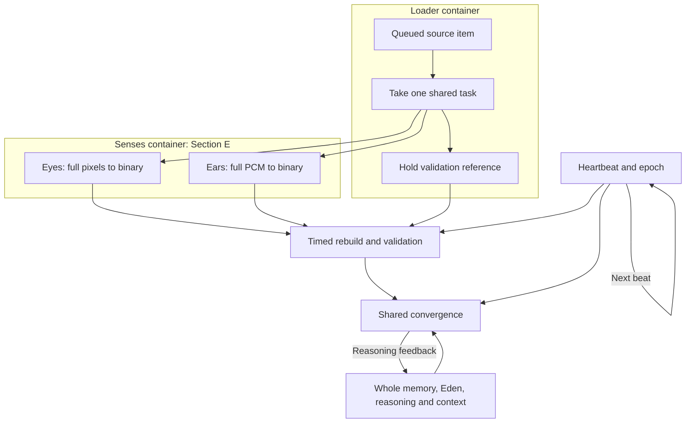

# Shakti — operating Guide

Updated 2026-10-19. Owner: Tyler Allen Lofall.
Repository: TylerALofall/Shakti_No_Dream_WithOut_The_Team.

This is the single project README and operating Guide. Read this before
choosing a source file or starting a new implementation. It carries the
section meanings, component boundaries, current source map and work method.
Sealed tool-package records describe their own versions; they are not
alternate project architecture guides.

**Scope review is in progress. Tyler's full drawing comes before source
relocation or further subsystem implementation.** The loader and sensory
containers below are the agreed boundary to preserve. Their final source
placement must follow that scope. This README update does not move code.

## 1. Start a session here

1. Record the repository, branch and exact commit being inspected.
2. Find the component's logical section in the table below.
3. Check the current source map: an intended home is not proof that code
   already lives there or is connected.
4. Read the affected source, its public interface and its actual callers.
   Reuse the existing implementation. Resolve competing copies explicitly.
5. State the bounded change, incoming data, outgoing data and buffer owner.
6. Review the changed source before compiling; inspect the build result
   before the separate native RUN. Publish only the authorized scope.
7. Record the result and remaining gaps here or in the existing package
   evidence. Do not create another project operating guide.

Work section by section. A repository inventory is a navigation index,
not a claim that someone has read or qualified every file. Follow changed
code and its dependencies; keep cross-section handoffs traceable.

## 2. Standing implementation rules

- C99, deterministic byte processing and fixed bounded storage.
  No explicit malloc/calloc/realloc/free or heap-owned model state.
- No Python or Node in, on or against Shakti files. Delivered tools do not
  launch compilers, subprocess builders or hidden background work.
- Review source before build, and build output before RUN. Reading and
  making an adaptive edit are separate reviewed actions.
- No external links, W3C/SVG tags, remote assets, trackers or dependencies
  added to Shakti artifacts or tools. Device access is explicit.
- Capacity overflow refuses the whole item with a clear BENCH. Never admit
  a truncated frame, clip, capsule or partial generated output.
- Keep one authoritative implementation for each runtime job. A kernel
  caller does not take ownership of a subsystem merely by calling it.
- Preserve section meanings and existing identities. A proposed rename,
  replacement or move must be visible in the scope and Git change list.
- Native RUNs supply actual evidence. Synthetic fixtures, injected boundary
  positions and missing independent review must be identified honestly.
- Existing tools are reused and packaged through the native README
  assembler in the Menu tool bank. Registry and seal history are append-only.

## 3. Section meanings

These meanings come from Tyler's supplied Guide and operational companion.
They describe responsibility; they do not certify that every section is
implemented, correctly placed, connected or qualified.

| Section | Responsibility | Boundary |
|---|---|---|
| A | Kernel | Bootstrap, lifetime, scheduling and core service calls. |
| B | Eden / resident foundation | Deterministic foundation and its prenatal preparation. |
| C | Four channels / connectors | Declared handoffs among sight, hearing, reasoning and available context. |
| D | Model-side controller / engine | Coordinate task processing and model-side control. |
| E | Senses | Eyes and ears; complete sensory breakdown, reconstruction and validation. |
| F | Memory | Working, short-term and long-term containers; recall, retention and organization. |
| G | Nine-point loop / internal MCP | The nine slots below; tools belong under its Menu. |
| H | Actuator / shell / children | Actions and execution interfaces, enabled in learned order. |
| I | School / training | Curriculum, cumulative practice and measured mastery. |
| J | Math / notes / factors | Deterministic calculations and supporting records. |
| M | Tyler's console | The human-facing controller boundary. |
| N | Lock / integrity | Integrity, identity and protection boundaries. |

The supplied companion retires standalone K, L and O assignments. Do not
invent meanings or use unassigned letters as overflow folders. Tyler's
full scope decides any revision. Reflection is Gi, not a new section.

**E means senses; F means memory.** A generic binary filename is not enough
evidence to assign its implementation to F. The full scope must settle
shared services and container homes before moves are made.

## 4. Separate loader and sensory containers

The boundary is **[loader] | [ears | eyes]**.

| Container | Owns | Hands off |
|---|---|---|
| Loader | Intake, loading-zone queue, item identity, task ownership and held validation reference. | A shared task describing the actual source item, its timeline and required sensory channels. |
| Eyes | Full-size pixels/pages, binary processing, rebuilt visual data and validation state. | Validated visual data at the task's source position. |
| Ears | Original PCM samples, binary processing, rebuilt audio data and validation state. | Validated audio data at the matching source position. |

One movie is one source task with visual and audio channels. Eyes and ears
may use that same item; neither creates an unrelated second task or a new
source library. A still picture/document activates its visual channel; a
sound item activates its audio channel. Only required channels participate.
Normal vision retains full-size pixels. The 8x8 exercise belongs to
handwriting practice; it is not the resolution of her eyes.

Keep task identity, source position, epoch receipts, reference ownership
and buffer lifetime explicit. Sharing an item does not permit a processor
to overwrite another channel's leased buffers. Input, held reference,
binary work and rebuilt output remain distinct where required for validation.

This is a partial container contract for scope review, not a generated
function-call graph or a claim that the final module split is implemented:

The diagram illustrates a movie; channel presence is governed by the task.
A failed or incomplete reconstruction holds that task and grants no
validated exposure. The heartbeat, memory and reasoning continue cycling.
With no new item, the loop continues with its existing memory and thoughts.

Every presentation of sound or light traverses binary breakdown, rebuilding
and matching before publication. Reusing a recording or a buffer does not
reuse a previous validation as credit for a new presentation. Eyes and mind
consume the actual rebuilt data through the shared convergence view.

## 5. Heartbeat and continuous loop

The heart is the shared timing trigger. At rest it advances one logical
beat per second; each beat has 32 sight slots and 64 hearing slots. Their
2:1 ratio remains exact when the shared rate changes. The current native
control accepts 1, 2, 4, 8, 16, 32 and 64 beats per physical second;
actual device throughput still needs qualification.

Source position and epoch have different jobs: source position aligns the
item's sound and sight; epoch records the live sequence of events. Replaying
an item changes its run identity without moving the live epoch backwards.

The loop runs without a reply. Holding a tool, waiting for reflection
answers, an empty loading zone or pausing training intake does not stop the
kernel loop or clear RAM. Live exposure replay stays inside the running
instance. Actual process termination needs durable recovery; recovery is
not a promise that physical RAM survives a device restart.

Eden, recalled whole memories, reasoning feedback and available context
remain participants in convergence. The full scope must show these paths,
including long-term recall into short-term and current work.

## 6. Memory and arenas

Memory items travel as whole containers with their context. Recall copies
the container; the original remains in long-term storage. Use refreshes
short-term idle lifetime. Shakti chooses her organization outside the
fixed Eden boundary, and the chosen method and location must be preserved.

- Working memory covers about 20–90 logical heartbeat seconds.
- Short-term memory holds whole recent containers and retained references.
  Permanent training and decaying recent events have different policies.
- At least five distinct completed reflections consolidate a pending
  container before long-term admission. Each reflection has 13 real answers.
- Long-term memory is the stored chronological library: epoch first,
  context, answers, tags, references and organization retained together.

A fixed arena can contain bounded subarenas. Reserved playlist/foundation
space and Shakti-organized short-term space are part of the scope being
defined; they are not automatically provided by the existing movie arena.

**Current code:** the 512 MiB reservation is media retention: 448 MiB history,
32 MiB latest window and 32 MiB processing/recovery work. Working and
short-term capsules use separate fixed pools. A general whole-memory
playlist with a guaranteed resident reservation remains open.

Movie thinning is a retention policy after full sensory processing. The
native policy can retain alternate frames after 20 minutes and a quarter
after 40, thinning further when bytes require it while preserving timeline
references. PCM stays pending until an actual transcript is supplied;
there is no built-in speech recognizer or learned category organizer yet.

Local scripts and assets need stable stored versions linked from their
complete containers. A logical reference field is not proof that a complete
automatically organized script/asset library has been implemented.

## 7. Prenatal input and later learning

Prenatal exposure is loaded through the same intake and sensory cycle.
It does not bypass eyes/ears, supply text answers as perception or fabricate
reflection answers. The progression is:

| Logical beats | Input allowed |
|---|---|
| 1–11,491,200 | Heartbeat only. |
| 11,491,201–15,120,000 | Heartbeat plus recorded sound. |
| 15,120,001–22,982,400 | Heartbeat, recorded sound and full solid color. |

22,982,400 = 266 days × 86,400 seconds. The count advances on completed,
validated exposures. Testing a boundary with an explicitly synthetic prefix
does not prove that the prefix was processed or learned.

The current eight colors are black, red, green, yellow, blue, magenta,
cyan and white. Each word/color occupies two beats so recordings longer
than one second keep their tails. All 32 visual frames in a beat are solid.
The first 16 sound beats and first 16 color beats use the resting pace,
then return to the requested shared rate.

The light phase permits 982,800 beats and 31,449,600 full-frame passes per
color, including 491,400 complete two-beat word/color presentations. Those
are schedule totals, not evidence of a completed full run or learned mastery.

There are nine reusable WAV source files, including the quiet pulse.
Together with the profile they occupy 235,122 bytes. The complete sealed
v2 package occupies 330,730 bytes. Full-size processing buffers and growing
epoch logs are separate. There is no source file per flash or repetition.

Exposure counters are operational metadata; they are not words displayed
as sensory input. New counting recordings, meaningful phrases, other
sounds and pattern sequences need an explicit playlist extension. Their
effects on learned organization must be measured rather than assumed.

After prenatal delivery the intended curriculum is counting, ABC, colors,
shapes and math, followed by the memory game as the first interactive
training. ASCII/L0 stays in the cumulative rotation. Each level revisits
earlier learning; actuator keys are enabled in the order actually learned.
That curriculum/actuator progression and mastery controller remain open.

## 8. Nine-slot MCP

| Slot | Name | Role |
|---|---|---|
| Ga / 1 | Epoch | Ordered event addresses and records. |
| Gb / 2 | Heartbeat | Shared pace for the loop and channels. |
| Gc / 3 | Goal | Current objective. |
| Gd / 4 | Notebook | Notes and reminders. |
| Ge / 5 | Multi-tier Menu | Local tool and library navigation. |
| Gf / 6 | Shell / tool call | Gated execution interface. |
| Gg / 7 | Outbound | Messages and notes to Tyler. |
| Gh / 8 | Inbound | Tyler's messages and notes to Shakti. |
| Gi / 9 | Self-reflection | Thirteen real answers, recorded by epoch. |

The current native tool gate requires reflection after 10 actual tool calls.
Required answers may remain pending while the loop continues. Existing
native code also requests timed reviews for pending capsules. Neither a
heartbeat nor an automatically presented frame is a fabricated tool call.

Reflection metadata supplies search triggers and explicit memory links.
It must recall complete containers with context. Fixed questions and real
answers belong to the container record; they are not invented by a loader.

## 9. Current published implementation — facts, not target placement

Reviewed main: b079eb159d3d1edaa4d6e0802d1453490fff72a2.
It contains all 649 files from reviewed branch commit
5106e2e3af9bb2dea731a74ddc669d182d7f7b4a byte-for-byte, plus
WO-M-womb_decode_c-A.txt. The audited tree has 650 files.

The published native build has 21 C translation units: 20 in SECTION-A,
plus SECTION-B/shakti_prenatal_loader.c. This concentration in A does
not follow the intended subsystem ownership. The pending placement
correction is not represented here as a completed integration.

| Current published path | Actual job |
|---|---|
| SECTION-A/main.c | Native initialization, command routing, queue/view entry points and console host. |
| SECTION-A/shakti_loop.c | Continuous cycle, shared pacing, module calls, reasoning feedback and reflection gate. |
| SECTION-A/shakti_media.c | Full-size sensory queue, binary encoding, validation and shared publication. |
| SECTION-A/shakti_rebuild.c | Rebuild bytes from binary planes. |
| SECTION-A/shakti_prenatal_flow.c | Ordered prenatal schedule, source ownership, counters and replay controls. |
| SECTION-B/shakti_prenatal_loader.c | Bounded profile/WAV/pixel preparation. |
| SECTION-A/shakti_loader.c | Existing bounded 4,096-byte artifact file reader; not the full-size sensory queue. |
| SECTION-A/shakti_memory.c | Whole capsule stages, reflection consolidation, persistence and recall. |
| SECTION-A/shakti_retention.c | Fixed movie arena, timeline thinning, PCM/transcript and release contracts. |
| include/ | Public interfaces shared by the active C modules. |

The existing SECTION-E/eyes*.c programs are not linked by this native build.
Their font/document demonstrations are not the new full-byte-preserving
sensory implementation. The next scope must reconcile existing and active
code explicitly, without silently building another eyes/ears system.

The artifact reader, prenatal preparation, prenatal scheduling and sensory
queue are existing jobs with different interfaces. Use these interfaces
when defining the single loading container, and identify which jobs remain
sensory processing. Reuse their implementations instead of duplicating them.

Other A build inputs are shakti_artifact.c, shakti_asset.c,
shakti_handwriting.c, shakti_log.c, shakti_manifest.c,
shakti_reason.c, shakti_receptor.c, shakti_report.c, shakti_school.c,
shakti_score.c, shakti_tablet.c and shakti_time.c. Presence in the repository
does not add another source to that executable.

Native evidence is recorded in Cycle-Run-v2.0.0-2026-10-18 and
Prenatal-Loader-v2.0.0-2026-10-19 under the Menu tool bank. The prenatal
integration RUN checked 1,122 real windows, including 544 full-size frames,
live pause/replay, corruption/refusal and recovery boundaries. Injected
prefixes were marked synthetic; the production build rejects them.

These RUNs demonstrate the named mechanical contracts. They do not certify
all sections, a full prenatal run, learned perception or independent review.

The source placement draft made after this main audit is paused locally.
It has not been published or qualified. No Runtime-Layout package, new
build manifest or per-section operating README is adopted by this revision.

## 10. Runtime entry and qualification boundary

The native controller initializes once with shakti_app_initialize.
It keeps scheduling shakti_app_cycle, including quiet cycles with no
command. The kernel's loop calls the sensory step; a complete validated
source window is exposed through shakti_app_convergence_view. Keep calls
serialized and respect each returned view's lifetime.

Current build, from the repository root of the pinned source revision:

    cc -std=c99 -pedantic -Wall -Wextra -Werror -O2 -Iinclude SECTION-A/*.c SECTION-B/shakti_prenatal_loader.c -o shakti-runtime

This records the existing build, not approval to place new subsystems
inside A. Replace its source selection only as part of the agreed scope.
Do not compile every C file in every section; many contain standalone mains.

Swift/iOS file picking, codecs, actual speaker/display bindings, lifecycle
and device throughput remain unqualified. A future host must deliver real
decoded bytes through MCP, display validated rebuilt output and use the
same C heartbeat and memory state. A mockup is not a native bridge.

## 11. Tools, Guide workflow and QA

The Guide's job is navigation and bounded work. Start from a section,
locate the existing implementation, read the actual input/output handoffs
and compare them with the task. A source file, parser instrument, native
RUN, saved record and runtime module are different roles.

The tool bank is SECTION-G/MCP/5-Menu/TOOLS. Its TOOLS_LEDGER.txt is the
append-only package/seal record. A package's supplied record and generated
README carry its exact BUILD, COMMAND, EXAMPLE, required inputs and hashes.
Use those records rather than copying stale tool paths or compiler recipes
into a second project guide. Old source-bound recipes require their pinned
revision or explicit requalification against current sources.

The native assembler is Tool/Tool-Assembler-v7.1.0-2026-10-17 in that bank.
It copies and seals approved files, writes README last and appends the
package registration. It does not compile or execute submitted tools.
Changed packages receive a new version; existing seals are not edited.

The code-to-chart workflow remains scan, collect, template, fill, merge,
diff and chart. Use the existing Call, Xml, Batch and Line tool records
for their concrete inputs and commands. Scan fresh/isolated copies.
A broken handoff is reported at that stage; an invented intermediate file
does not repair it.

Preserve the current tool's issued identities and XML schema. Record file,
function name, source order and any issued address; do not invent or
renumber identities from line numbers. FILE:LINE is a fresh locator.
Earlier address schemes are historical; migration is a separate decision.

Per-function review records what is processed, where inputs originate,
where outputs go and why the function exists. Descriptions stay within the
work-order limit. Preserve template fields and ordering; uncertain evidence
stays incomplete. Current QA instructions are in
COPILOT_INTAKE/QA_specialist_Instruction.md. Use assigned work orders and
current QA inputs/outputs rather than obsolete Library/Templates paths.

The chart renderer draws recorded facts. Batch large maps by SECTION and
preserve explicit cross-section links. A conceptual scope diagram is not a
measured C call graph, and neither makes an unfinished interface complete.

Keep builder evidence separate from independent review. Never sign a
review that was not performed. An old model roster or expired weekly quota
is not a current authorization.

## 12. Publication and handoff

Current code/document review branch: shakti/menu-moved-2026-10-15.
A review-branch push is not an instruction to update main. Tyler controls
the main integration unless he explicitly delegates that action.

Before a push, name the exact parent and changed paths, review the diff
and verify that all unrelated files and package seals remain intact.
After it, verify the remote blob/tree, parent and branch, pull the bytes
back and compare them. Base64 transport preserves source bytes without
retyping XML payloads. Any discrepancy is reported and corrected visibly.

For each bounded handoff retain: commit, section, authoritative file,
interface/callers, exact change, actual RUN result, open issue and next
permitted step. Start the next session from those repository facts.

**Next permitted architecture step:** Tyler supplies the full scope.
Then reconcile the single loader container and its shared eyes/ears task
with section ownership, existing code, memory and the forever loop.
Source moves and new implementations follow that drawing; they do not
precede it.
